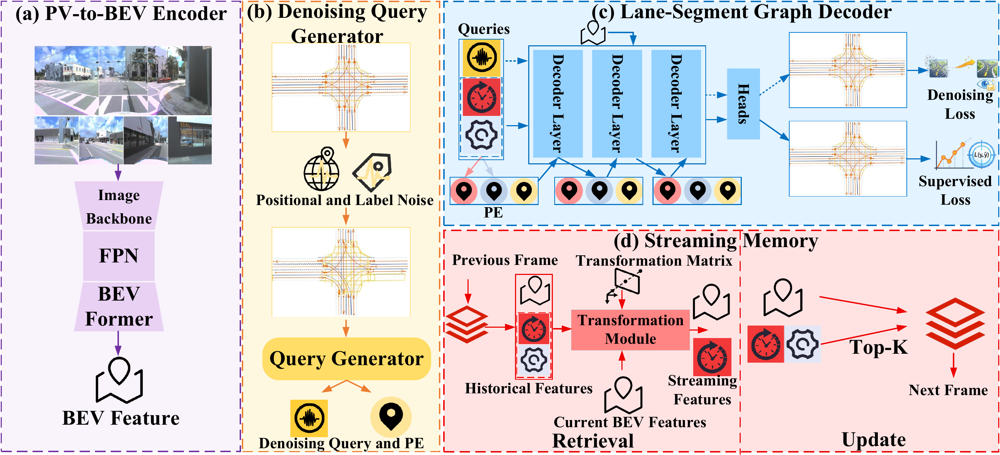

<div align="center">

# TopoX
### Spatio-Temporal Lane Graph Generation via Iterative Positional Embedding and Denoising

**KDD 2027**

Yiming Yang<sup>1</sup>,
Yueru Luo<sup>1</sup>,
Hongbin Lin<sup>1</sup>,
Bingkun He<sup>4</sup>,
Suzhong Fu<sup>1</sup>,<br>
Chao Yan<sup>2</sup>,
Yameng Wang<sup>2</sup>,
Chao Zheng<sup>2</sup>,
Chen Lv<sup>3</sup>,
Shuguang Cui<sup>1</sup>,
Zhen Li<sup>1</sup>

<sup>1</sup> CUHKSZ &nbsp; <sup>2</sup> Tencent &nbsp; <sup>3</sup> NTU &nbsp; <sup>4</sup> JHU

[Preprint](https://arxiv.org/abs/2507.00709) · [Model weights](https://huggingface.co/y352184741/TopoX) · [Installation](docs/installation.md) · [Data preparation](docs/data.md)

</div>

TopoX builds lane graphs from surround-view video, jointly predicting lane geometry, boundary semantics, pedestrian crossings, and directed connectivity. Iterative positional embedding refines lane queries through the decoder, denoising strengthens structured prediction, and temporal graph propagation carries both lane features and their adjacency into the next frame.

## News

- **2026-11:** TopoX has been **accepted to KDD 2027**!
- **2026-11:** We release the core training and inference code, our checkpoint with temporal adjacency propagation, and the latest OpenLane-V2 results.

## Architecture

[](assets/framework.pdf)

TopoX combines a multi-camera PV-to-BEV encoder, a denoising query generator, a lane-segment graph decoder with iterative positional embedding, and streaming memory.

## Results

### OpenLane-V2 Subset A

Validation on **150 scenes / 4,806 frames**, using the LaneSegNet/OpenLane-V2 v2.1 lane-segment evaluator. All scores below are percentages; higher is better.

| Model | Backbone | mAP | AP_lane | AP_ped | TOP_lsls | Config |
|---|---|---:|---:|---:|---:|---|
| TopoX | ResNet-50 | 39.06 | 37.40 | 40.71 | 30.15 | [Temporal graph](configs/topox_stage2.py) |
| **TopoX + GeoDist** | **ResNet-50** | **39.06** | **37.40** | **40.71** | **32.10** | [Temporal graph + GeoDist](configs/topox_stage2_geodist.py) |

Both rows use the released TopoX checkpoint. GeoDist refines its output adjacency with endpoint-distance scores. [Exact results](docs/results.json).

## Quick start

Follow [installation](docs/installation.md) and [data preparation](docs/data.md), then download the checkpoint:

```bash
mkdir -p checkpoints
curl -L --fail --retry 3 \
  https://huggingface.co/y352184741/TopoX/resolve/main/topox_r50_openlanev2_subset_a.pth \
  -o checkpoints/topox_r50_openlanev2_subset_a.pth
```

Evaluate the main result:

```bash
bash tools/dist_test.sh 1 checkpoints/topox_r50_openlanev2_subset_a.pth
```

Evaluate the learned graph with the same weights:

```bash
CONFIG=configs/topox_stage2.py \
  bash tools/dist_test.sh 1 checkpoints/topox_r50_openlanev2_subset_a.pth
```

Use `--show` for per-frame visualization. Evaluation assigns complete scenes to each GPU and preserves frame order.

## Training

The released schedule uses **4 GPUs, 2 samples per GPU, and seed 42**. Stage 1 learns per-frame lane representations for 12 epochs; stage 2 trains temporal graph propagation for 33,516 iterations.

```bash
bash tools/dist_train.sh 4 1
bash tools/dist_train.sh 4 2
```

Stage 2 automatically loads `work_dirs/topox/stage1/latest.pth`. The final checkpoint is saved under `work_dirs/topox/stage2/`. Set `CUDA_VISIBLE_DEVICES` to choose GPUs, or `PORT` to choose the distributed port. See [training and evaluation](docs/evaluation.md) for configuration details.

## Repository

```text
configs/             Two-stage training and GeoDist evaluation configs
topox/models/        TopoX detector, iterative decoder, and graph propagation
topox/streaming/     Temporal memory, motion updates, and sequence samplers
topox/bev/           Multi-camera BEV construction
topox/datasets/      OpenLane-V2 inputs, transforms, and prediction formatting
topox/core/          Matching, evaluation hooks, and GeoDist
tools/               Data preparation, training, and evaluation entry points
tests/               Directed propagation and GeoDist checks
```

## Visualizations

<div align="center">


</div>

## Citation

```bibtex
@article{yang2025topostreamer,
  title={TopoStreamer: Temporal Lane Segment Topology Reasoning in Autonomous Driving},
  author={Yang, Yiming and Luo, Yueru and He, Bingkun and Lin, Hongbin and Fu, Suzhong and Zheng, Chao and Cao, Zhipeng and Li, Erlong and Yan, Chao and Cui, Shuguang and Li, Zhen},
  journal={arXiv preprint arXiv:2507.00709},
  year={2025}
}
```

## Acknowledgements and license

TopoX builds on [LaneSegNet](https://github.com/OpenDriveLab/LaneSegNet), [SQD-MapNet](https://github.com/shuowang666/SQD-MapNet), [StreamMapNet](https://github.com/yuantianyuan01/StreamMapNet), and [BEVFormer](https://github.com/fundamentalvision/BEVFormer). We use [OpenLane-V2](https://github.com/OpenDriveLab/OpenLane-V2) for data and evaluation, and [TopoLogic](https://github.com/Franpin/TopoLogic) for GeoDist.

Code is distributed under [GPL-3.0](LICENSE), with upstream notices retained in [NOTICE](NOTICE) and [licenses/](licenses/).
